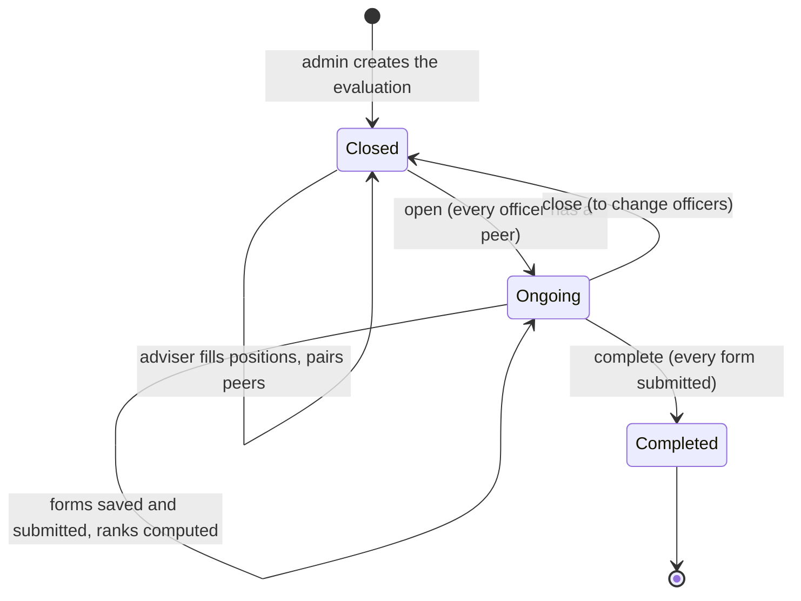
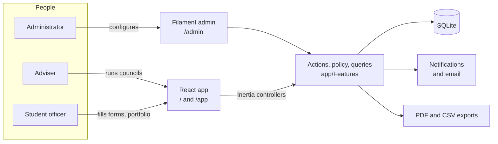
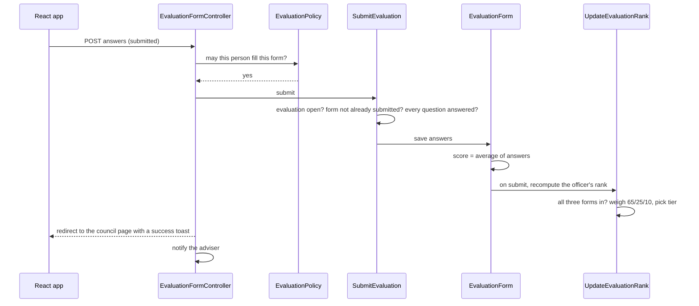
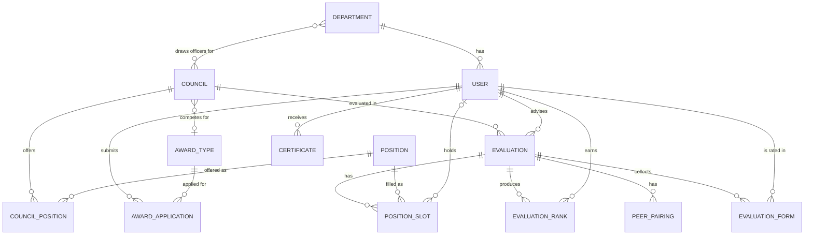

<div align="center">

[](README.md)

</div>

### Overview

Every school year the Paulinian Student Government (PSG) of St. Paul University Philippines assesses its student officers. Advisers, fellow officers and the officers themselves fill in a printed leadership rubric, someone tallies the scores by hand, and the results decide who is ranked Gold, Silver or Bronze and who is considered for the leadership awards. The PSG e-Portfolio and Ranking System moves that whole cycle online.

The core idea is that **an officer's rank is computed, never typed**. Each officer is rated on three forms built from the same rubric (adviser, peer and self), each form scores the average of its answers, and the moment all three are submitted the system weighs them into a final score and a rank. Nobody tallies anything, and every rank can be traced back to the answers behind it.

The system has three parts:

- **The sign-in page** (`/`), shared by everyone. Admins land in the admin panel, everyone else in the app.
- **The app** (`/app`), a React app where student officers fill in their self and peer forms, keep their portfolio and apply for awards, and where advisers run their councils' evaluations, manage their department's students and issue certificates.
- **The admin panel** (`/admin`), a Filament panel where administrators set up departments, councils, positions and award types, create each year's evaluations, manage accounts, and accept or reject award applications.

### How It Works

A council evaluation, from setup to final rank:

1. **Create.** An administrator creates an evaluation for a council and school year and assigns its adviser. The system creates one empty slot for every position the council has (for example one Governor, eight Councilors).
2. **Set up.** While the evaluation is *closed*, the adviser fills each slot with a student from the council's departments and pairs every officer with a fellow officer as their peer evaluator.
3. **Open.** The adviser opens the evaluation. It only opens once every officer has a peer evaluator. Officers, the adviser and the admins are notified.
4. **Evaluate.** Each officer writes a self evaluation and a peer evaluation for the officer they were paired with. The adviser writes an adviser evaluation for every officer, with length of service filled in from the officer's history. Forms can be saved as drafts; a submitted form is final. The adviser can email reminders for missing self and peer forms.
5. **Score.** When a form is submitted it is scored (the average of its answers, 0 to 3). As soon as an officer has all three, their final score is computed (adviser 65%, peer 25%, self 10%) and turned into a rank: Gold from 2.41, Silver from 1.81, Bronze from 1.21.
6. **Complete.** Once every form is in, the adviser completes the evaluation. Ranks are final and every form becomes read-only. The adviser can close an open evaluation again to change officers, but a completed one cannot be reopened.
7. **Apply.** A graduating officer whose evaluations are all completed can apply for a leadership award from their portfolio. An administrator accepts or rejects it, and the student is notified and emailed.

In this MVP a submitted form cannot be edited or withdrawn, each officer has exactly one peer evaluator, and award applications are decided by hand: a rank does not grant an award by itself.



### Architecture



The backend is one Laravel application organised by domain under `app/Features` (evaluations, councils, positions, awards, certificates, users). The admin panel is built with Filament and talks to the same models. The app is React with TypeScript, served through Inertia, so each page gets its data straight from a Laravel controller with no separate API, and Wayfinder generates typed route helpers so the React code never hardcodes a URL. Every rule about who may see or change an evaluation lives in one policy, `EvaluationPolicy`; the React app only shows what the server says the person may do.

This is what happens when an officer submits a form:



**Key decisions**

- **Ranks are computed on save, from model hooks.** Saving a form scores it, and submitting one recomputes the officer's rank, so there is no "calculate rankings" step that can be forgotten or run on stale data.
- **The rubric lives in code.** The domains, strands, questions and rating descriptions are the university's fixed leadership rubric, so they are a structure in `EvaluationForm` rather than admin-editable data; the self and peer forms are subsets of the adviser form.
- **One policy decides access.** `EvaluationPolicy` answers who can view a council, manage it, fill a form and read a form. Controllers, form requests and the officer list all ask it, so the rules cannot drift apart.
- **Council setup is a set of small actions.** Opening, closing, completing, filling a slot, pairing a peer and sending reminders are each one action class with its own rules, shared by every caller and covered by tests.
- **Admins configure, everyone else works in the app.** Filament gives administrators full data management for little code; advisers and students get a purpose-built React app instead of a generic admin screen.
- **SQLite and one container.** The system serves one student government, so a single SQLite file in the storage volume is enough, and the Docker image runs migrations and seeds the reference data on start.

### Domain Model



| Concept | Meaning |
|---|---|
| Department | A school of the university. Students and advisers belong to one; a council draws its officers from its departments. |
| Council | A student government body: the campus-wide PSG or a school's departmental PSG. Each competes for one award type. |
| Position | An office such as Governor or Senator, with its branch (Executive, Legislative, Judiciary, Mayoral) and rank order. |
| Council position | A position a council offers, and how many people hold it. |
| Evaluation | One council's assessment for one school year, run by one adviser. It is closed, ongoing or completed. |
| Position slot | One seat in an evaluation, filled by a student officer. |
| Peer pairing | Which fellow officer writes an officer's peer evaluation. |
| Evaluation form | One filled rubric: self, peer or adviser, for one officer, saved as a draft or submitted, with its average score. |
| Evaluation rank | An officer's final weighted score and tier (Gold, Silver, Bronze) for one evaluation. |
| Certificate | A PDF issued to a student, shown in their portfolio. |
| Award type | The Campus or Departmental Leadership Award. |
| Award application | A graduating officer's request for an award, pending until an admin accepts or rejects it. |

### Permissions

| Who | Can |
|---|---|
| Administrator | Everything in the admin panel: departments, councils, positions, award types, accounts, certificates; create and edit evaluations, read every form and export it; accept or reject award applications. Cannot fill forms unless they advise the council. |
| Adviser | In the councils they advise: fill positions, pair peers, open, close and complete the evaluation, send reminders, write adviser forms, read and export every form. In their department: add and edit students, read their portfolios, issue certificates. |
| Student officer | In the councils they serve in: see the council and its officers, write their self evaluation and the peer evaluation they were assigned. Keep their profile and portfolio, see their certificates, and apply for an award once all their evaluations are completed. |

### Notifications, Exports and Dashboards

- **In-app notifications.** Officers are notified when they are added to a council, when an evaluation they are in opens or completes, and when they receive a certificate; advisers when a form is submitted; admins when an award application arrives; students when it is decided. The bell in the app header refreshes every 30 seconds. Notifications are stored with Filament's database notifications, so admins see the same ones in the admin panel.
- **Email.** Advisers' reminders and award decisions are also sent by email. The Docker image sends them straight away; in development they go through the queue worker that `composer dev` runs.
- **Exports.** Any submitted form can be downloaded as a CSV or a PDF (rendered with DomPDF) by the council's adviser or an admin.
- **Certificates.** An adviser uploads one PDF and issues it to several students at once; each gets their own record pointing at the shared file.
- **Admin dashboards.** The admin home shows system totals and the evaluations still in progress. Each evaluation's page adds its submission progress, its top-ranked officers and the score range recommended for each branch, and the user, council, position and award application lists each open with summary counts.

### Stack

| Layer | Technology |
|---|---|
| Language | PHP 8.4, TypeScript 5.9 |
| Framework | Laravel 12 |
| Admin panel | Filament 4 |
| App front end | React 19 with Inertia 3 (inertia-laravel 3.7), Wayfinder 0.1 for typed routes |
| Styling | Tailwind CSS 4, lucide-react icons, sonner toasts |
| Build | Vite 7 |
| PDF | barryvdh/laravel-dompdf 3 |
| Database | SQLite |
| Tests and quality | Pest 4, Larastan 3 (level 4), Laravel Pint, Prettier |
| Deployment | Docker (serversideup/php 8.4 FPM + NGINX) |

### Project Map

```
app/
├── Features/                 the domain, one folder per area
│   ├── Evaluations/          evaluations, forms, ranks and peer pairings
│   │   ├── Actions/          submit a form, change status, fill a slot, pair a peer, remind, compute ranks
│   │   ├── Controllers/      council list and page, officer controls, forms, exports
│   │   ├── Enums/            evaluator weights (65/25/10) and rank tiers
│   │   ├── Policies/         EvaluationPolicy: who may view, manage, fill and read
│   │   └── Queries/          the council's officer board and each person's pending forms
│   ├── Awards/               award types and applications
│   ├── Certificates/         certificates and issuing them
│   ├── Councils/  Departments/  Positions/
│   ├── Home/                 the app's first screen
│   ├── Landing/              sign-in page statistics
│   └── Users/                users, sign-in, profile, portfolio, students, notifications
├── Filament/                 the admin panel: resources, pages and widgets
└── Providers/                gates, policy registration and the admin panel
resources/
├── js/                       the React app
│   ├── pages/                one file per screen (Login, app/Home, app/Council, ...)
│   ├── components/           sections per screen, shared pieces and UI primitives
│   ├── layouts/  lib/  hooks/  types/  data/
├── css/app/  css/admin/      app and admin panel styles
└── views/                    the React shell and the admin panel's Blade views
database/
├── migrations/
└── seeders/                  DatabaseSeeder (reference data and the first admin), DemoDataSeeder (sample data)
docker/entrypoint.d/          container start-up: prepare storage, seed reference data
tests/                        Pest feature and unit tests
```
