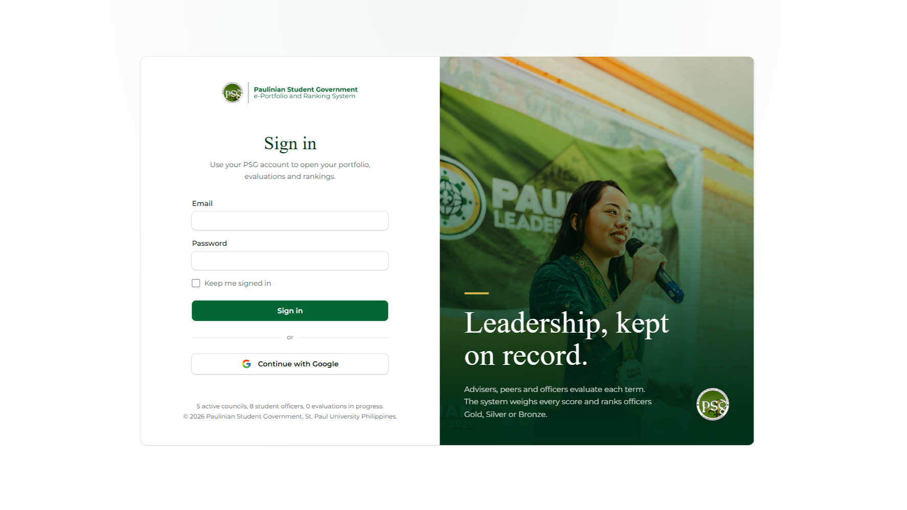
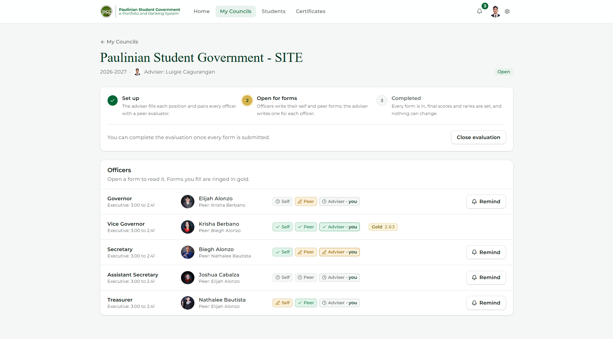
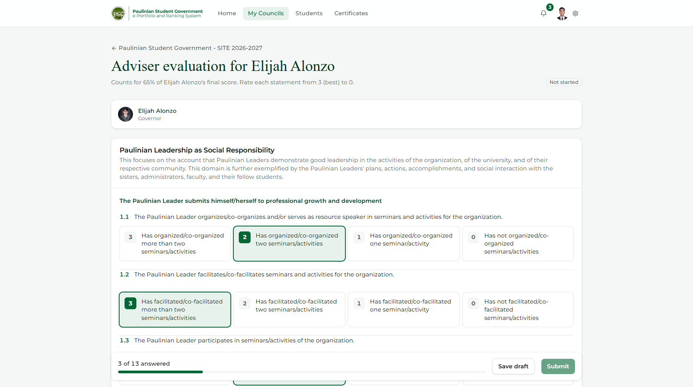
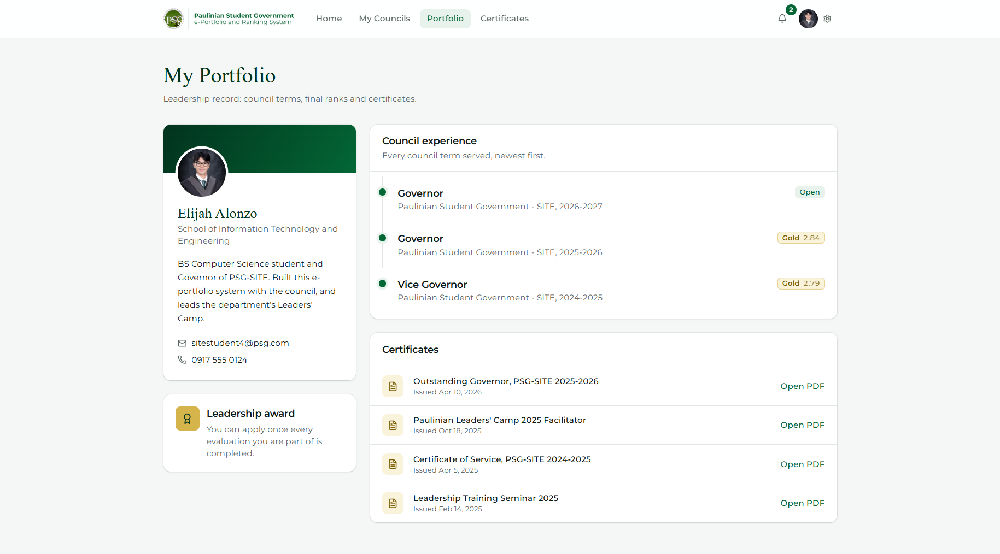

An evaluation and ranking system developed to automate the yearly assessment of student leaders in the Paulinian Student Government, replacing printed evaluation forms and hand-tallied scores with one online platform. The system allows student officers to rate themselves and a fellow officer, keep a leadership portfolio and apply for leadership awards, and gives council advisers the tools to run each council's evaluation, rate every officer and issue certificates, while administrators manage councils, positions and award decisions.

### Council Evaluation

The Council Evaluation page is where an adviser runs a council's yearly evaluation from start to finish. They fill each position with a student officer, pair every officer with a fellow officer who will rate them, open the evaluation, and follow each officer's self, peer and adviser forms as they come in, with a one-click reminder for anyone who is late. It replaces chasing paper forms and checking off names by hand, making it clear at a glance who is done and who still needs to submit.

### Evaluation Form

The Evaluation Form turns the council's leadership rubric into a simple online form. Each statement is rated from 3 to 0 by choosing the description that fits best, progress can be saved as a draft and finished later, and the officer's years of service are filled in automatically. It replaces the printed rubric and manual tallying: as soon as all three forms are in, the system works out the officer's weighted score and ranks them Gold, Silver or Bronze.

### Student Portfolio

The Student Portfolio gathers an officer's leadership record in one place: every council term they served, the position they held, their final rank for each year, and the certificates issued to them. Graduating officers apply for a leadership award straight from here once their evaluations are complete. It replaces folders of certificates and scattered records, giving students, advisers and award reviewers the same up-to-date view of each leader.

